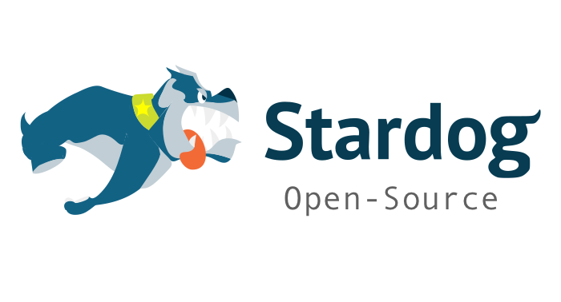

# Stardog Terraform Starters



Infrastructure-as-code starters for deploying the Stardog platform with Terraform on Azure, AWS, or GCP. This repo is organized around reusable modules and supporting assets that can be composed into environment-specific stacks.

## Disclaimer & Support Model

These Terraform starters are released under the Apache 2.0 License and are provided without express warranty or commercial support.

They are intended to be open-source starting points, not drop-in production blueprints. Every environment is different. These starters assume a relatively simple greenfield deployment and provide the minimum building blocks needed to get a Stardog platform up and running.

Some modules are broadly reusable, while others are intentionally Stardog-specific. You should expect to review and adapt them to fit your own enterprise requirements, security controls, CI/CD workflow, naming standards, networking model, and platform policies.

For production use, mirror the code into your own internal source control and artifact workflows, then version and test it within your own delivery process.

## What This Repo Contains
- Reusable Terraform modules for Azure, AWS, GCP, Kubernetes add-ons, identity, and Stardog resources
- Supporting scripts for backend bootstrap and day-to-day operations
- Container assets and reference docs used by starter environments
- Example compositions under `examples/` that show how to wire the modules together

This repo intentionally stops short of shipping opinionated environment compositions. Environment-specific stacks, CI/CD wiring, backend conventions, and organizational integration should live in a separate repo that depends on these starters.

## Prerequisites
- Terraform >= 1.5
- Cloud CLIs:
  - Azure: `az`, Helm, Kubectl, Python 3
  - AWS: `aws`, Docker, Helm, Kubectl, Python 3
- Access to JFrog (or alternative) container/Helm registry credentials
- Stardog license in base64 or a local file path

Your environment repo should document the exact variables to export (`TF_VAR_jfrog_registry_*`, `TF_VAR_stardog_license_base64`, backend settings, cloud account details, and any organization-specific inputs).

## Getting Started
1. **Bootstrap remote state** - use your existing Terraform state infrastructure or the helper scripts in `scripts/` (`README_BACKEND.md` documents the Azure option).
2. **Authenticate** - sign in to Azure (`az login`) and/or AWS (`aws sso login` or static keys) as required.
3. **Create or clone an environment repo** - compose the modules in this repo into cloud- and org-specific stacks, then define naming, IAM, DNS, networking, and policy conventions there.
4. **Set configuration** - populate the minimal variables your environment requires (`subscription_id`, `inst_id`, `app_owner_upns`, `dns_zone_name`, registry credentials, license data, and backend settings).
5. **Plan & apply** - run `terraform plan` / `terraform apply` from the environment repo and validate the resulting platform resources.

## Modules at a Glance
- **Azure**
  - [Resource group helper](modules/azure/rg/README.md)
  - [Container Registry](modules/azure/acr/README.md)
  - [Key Vault](modules/azure/akv/README.md)
  - [Key Vault secrets writer](modules/azure/kv_secrets/README.md)
  - [Kubernetes Service](modules/azure/aks/README.md)
  - [Workload identity helper](modules/azure/workload_identity/README.md)
  - Other helpers (no README yet): `aks_stop_schedule`
- **AWS**
  - [Network (VPC + subnets)](modules/aws/network/README.md)
  - [EKS cluster](modules/aws/eks/README.md)
  - [ECR repository + importer](modules/aws/ecr/README.md)
  - [Secrets Manager vault](modules/aws/secretvault/README.md)
  - [Secrets Manager entries](modules/aws/kv_secrets/README.md)
- **GCP**
  - [VPC network](modules/gcp/network/README.md)
  - [Artifact Registry](modules/gcp/artifact_registry/README.md)
  - [GKE cluster](modules/gcp/gke/README.md)
  - [Secret Manager vault](modules/gcp/secret_manager/README.md)
  - [Secret entries](modules/gcp/kv_secrets/README.md)
- **Docker build helpers**
  - [Azure ACR build](modules/docker/acr_build/README.md)
  - [AWS ECR build](modules/docker/ecr_build/README.md)
- **Identity (Microsoft Entra)**
  - [Shared Launchpad/SPARQL stack](modules/identity/human_entra/shared_stack/README.md)
  - [Launchpad application](modules/identity/human_entra/aad_launchpad/README.md)
  - [SPARQL application](modules/identity/human_entra/aad_sparql/README.md)
  - [App role assignment helper](modules/identity/human_entra/app_role_assignment/README.md)
- **Kubernetes add-ons**
  - [Ingress NGINX](modules/kubernetes/nginx_ingress/README.md)
  - [Ingress Traefik](modules/kubernetes/traefik_ingress/README.md)
  - [Envoy Gateway](modules/kubernetes/envoy_gateway/README.md)
  - [NGF (Gateway Fabric)](modules/kubernetes/ngf/README.md)
  - [cert-manager](modules/kubernetes/cert-manager/README.md)
  - [Stardog Helm stack](modules/kubernetes/stardog/README.md)
  - Other helpers (no README yet): `default_storage_class`, `haproxy_gateway`
- **Stardog resources**
  - [Role lifecycle](modules/stardog_resources/role/README.md)
  - [Role assignment](modules/stardog_resources/role_assignment/README.md)
  - [Role set orchestration](modules/stardog_resources/role_set/README.md)

## Repository Layout
```
modules/
scripts/
containers/
docs/
examples/
README_BACKEND.md
```

## Next Steps
- Build a thin environment repo that consumes these modules and captures your organization-specific defaults.
- Inspect module READMEs for deeper configuration options and provider-specific assumptions.
- Keep `.terraform.lock.hcl` in version control and avoid committing state files or secret tfvars.
